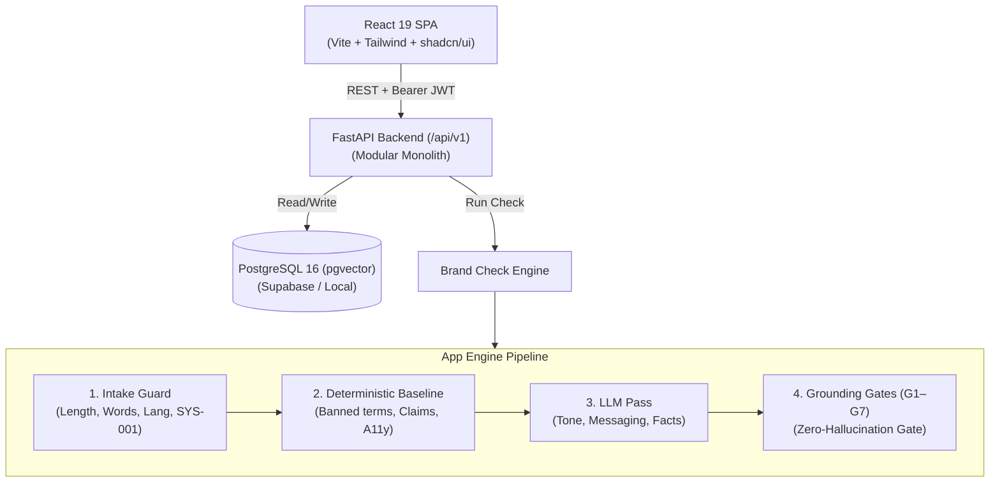

# Dhrishyam (दृष्यम्) — Pre-Publication Brand Governance Platform

[](https://www.python.org/)
[](https://fastapi.tiangolo.com/)
[](https://react.dev/)
[](https://www.docker.com/)
[](./tests)
[](./LICENSE)

> **Dhrishyam** inspects marketing copy, blogs, and announcements against approved brand guidelines, facts, terminology, and claim rules **before publication**. It flags violations, cites verifiable rules, offers minimal corrections, and orchestrates human review.

---

## System Architecture

Dhrishyam is implemented as a **modular monolith** with clear component boundaries:



### Core Product Principles
1. **Grounded or Silent**: Every finding must cite an approved guideline, fact, or terminology rule. Citations are strictly validated by the server (Grounding Gates G1–G7).
2. **Explain, Don't Reject**: Each issue is displayed with highlighted text, citation evidence, and a suggested inline replacement.
3. **Human Control**: AI never auto-applies edits or approves content. Reviewers and creators make all final workflow decisions.
4. **Governance Insights**: Computes rule violation frequencies and a **Clarity Score** (`0.6 × dismissal + 0.4 × override`) to detect unclear or disputed guidelines.

---

## Repository Structure

```text
prototype_v3.0_c/
├── .github/workflows/ci.yml         # Automated GitHub Actions CI pipeline
├── .env.example                     # Environment variable template
├── .gitignore                       # Production Git ignore rules
├── docker-compose.yml               # Multi-container orchestration (DB + API + Web)
├── pytest.ini                       # Central pytest configuration
│
├── docs/                            # Formal specifications & design docs
│   ├── PRD_Dhrishyam.md             # Product Requirements Document
│   ├── TRD_Dhrishyam_Technical_Requirements.md # Technical Architecture
│   ├── Software_Requirements_Specification.md  # IEEE 29148 SRS
│   └── Dhrishyam___UX_Screen_Breakdown__V1__7f651aed.md # UX screens
│
├── docker/                          # Centralized container definitions
│   ├── Dockerfile.backend           # FastAPI container (Python 3.12)
│   ├── Dockerfile.frontend          # React SPA container (Node 20)
│   └── .dockerignore                # Docker ignore definitions
│
├── backend/                         # FastAPI Application Package
│   ├── requirements.txt             # Pinned backend dependencies
│   ├── alembic.ini                  # Migration settings
│   ├── schema.sql                   # Supabase / PostgreSQL DDL
│   ├── alembic/versions/            # Database revisions
│   └── app/
│       ├── main.py                  # API application & middleware
│       ├── config.py                # Pydantic Settings
│       ├── db.py                    # SQLAlchemy session engine
│       ├── models.py                # 15 PostgreSQL models + 1 view
│       ├── auth.py                  # Supabase JWT verification & RBAC
│       ├── seed_loader.py           # Demo brand kit seeder
│       ├── api/me.py                # Identity & membership endpoints
│       ├── gates/                   # Grounding Gates (G1–G7)
│       ├── harness/                 # Deterministic rules, regex, a11y, claims
│       └── engine/                  # Check engine pipeline interface
│
├── frontend/                        # React SPA
│   ├── package.json                 # Web dependencies & scripts
│   ├── vite.config.ts               # Vite configuration
│   └── src/
│       ├── components/              # Workspace, cards, layout components
│       ├── pages/                   # Workspaces (Creator, Reviewer, Admin)
│       ├── services/api.ts          # API adapter (Live backend + Offline mock)
│       └── types/domain.ts          # TypeScript domain contracts
│
├── tests/                           # Unified Test Suite
│   ├── backend/                     # API, models, JWT & RBAC tests (5 files)
│   ├── engine/                      # Deterministic rules, gates G1-G7, tools (4 files)
│   └── frontend/                    # Client rulesEngine.test.ts
│
└── scripts/                         # Maintenance & experimentation utilities
    └── structured_output_test_call.py
```

---

## Quick Start with Docker (Recommended)

Run the full stack with isolated PostgreSQL, FastAPI, and Vite containers:

```bash
# 1. Clone repository and set up environment
cp .env.example .env

# 2. Build and launch all services
docker compose up --build
```

Access the services:
- **Frontend SPA**: [http://localhost:3000](http://localhost:3000)
- **FastAPI OpenAPI Docs**: [http://localhost:8000/docs](http://localhost:8000/docs)
- **Postgres Database**: `localhost:5432`

---

## Local Development Setup

### Backend (Python 3.12+)
```bash
cd backend
python -m venv .venv
source .venv/bin/activate    # Windows: .venv\Scripts\activate
pip install -r requirements.txt
alembic upgrade head
uvicorn app.main:app --reload --port 8000
```

### Frontend (Node 20+)
```bash
cd frontend
npm install --legacy-peer-deps
npm run dev
```

---

## Testing

The repository includes **219 automated unit & regression tests**:

```bash
# Run all Python tests (Backend + Check Engine)
pytest

# Run Frontend tests
cd frontend && npm run test

# Run Frontend TypeScript lint & build
cd frontend && npm run lint && npm run build
```

---

## User Roles (Demo Accounts)

In Demo Mode (`DEMO_MODE=true`), you can switch roles from the top bar:
* **Creator** (`Aarav Mehta`): Submit text or documents, run brand checks, accept suggestions, submit for approval.
* **Reviewer** (`Priya Nair`): Review queue, verify cited evidence, approve or request changes with comments.
* **Admin** (`Rohan Kapoor`): Brand Library maintenance, team roles, governance insights & clarity scores.

---

## License
MIT License. Created for the CodeNexus Hackathon.

